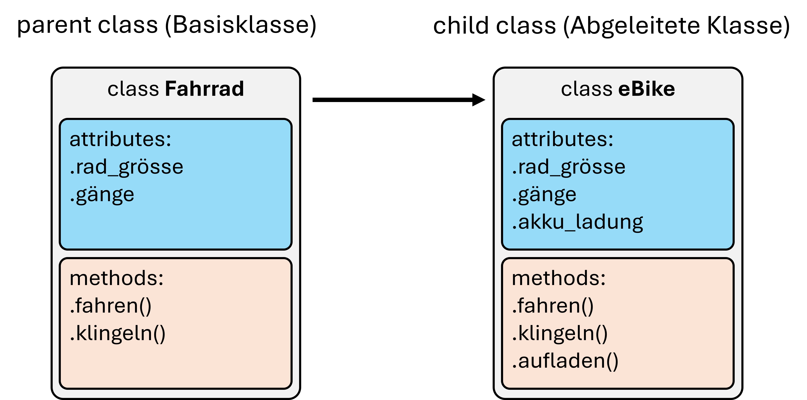

# Objektorientierte Programmierung in Python – Teil 2

In der letzten Einheit haben wir eigene Klassen definiert, Objekte erzeugt und ihren Zustand über Attribute und Methoden verändert. Als größeres Beispiel diente ein `Elevator`: Er kann einen aktuellen Zustand besitzen, Methoden ausführen und mit einem `Display`-Objekt zusammenarbeiten.

In diesem zweiten Teil geht es weniger darum, noch mehr Syntax kennenzulernen. Stattdessen schauen wir uns an, wie **mehrere Objekte zusammenarbeiten** und wie Klassen sinnvoll zueinander in Beziehung stehen können.

Im Mittelpunkt stehen dabei:

- Objekte als Attribute und in Listen,
- gemeinsame Referenzen auf dasselbe Objekt,
- **Komposition**: ein Objekt *hat* andere Objekte,
- **Vererbung**: ein Objekt *ist eine spezielle Form* eines anderen Typs,
- `super()`, Überschreiben von Methoden und `isinstance()`,
- sowie die Verteilung mehrerer Klassen auf verschiedene Module.

## Objekte können andere Objekte enthalten

Schon im letzten Kapitel hatten wir einen kleinen `Display`-Datentyp:

```python
class Display:
    def __init__(self):
        self.message = ""

    def show(self, message):
        self.message = message
        return self.message
```

Ein `Elevator` kann ein solches Display als Attribut besitzen. Wichtig ist dabei: Wir erzeugen das Display **außerhalb** des Aufzugs und übergeben das bereits existierende Objekt an den Konstruktor.

<!-- pytest-codeblocks:cont -->

```python
class Elevator:
    def __init__(self, name, accessible_levels, display):
        self.name = name
        self.accessible_levels = list(accessible_levels)
        self.current_level = 0
        self.display = display

    def description(self):
        return f"Aufzug {self.name}: Etage {self.current_level}"

    def move_to(self, level):
        if level not in self.accessible_levels:
            return False
        if level == self.current_level:
            return False

        self.current_level = level
        self.display.show(f"Aufzug {self.name}: Etage {level}")
        return True
```

<!-- pytest-codeblocks:cont -->

```python
main_display = Display()
elevator = Elevator("A", [-1, 0, 1, 2, 3], main_display)

print(elevator.display is main_display)  # => True
```

Das ist ein wichtiger Punkt: `main_display` und `elevator.display` verweisen auf **dasselbe Objekt**.

Der Aufzug hat also keine Kopie des Displays erhalten.

<!-- pytest-codeblocks:cont -->

```python
main_display.show("Wartung")

print(main_display.message)       # => Wartung
print(elevator.display.message)   # => Wartung
```

Die Änderung ist über beide Zugänge sichtbar, weil beide Namen auf dasselbe Objekt verweisen.

Genau wie bei Listen oder Dictionaries gilt also auch für selbst definierte Objekte: Wenn wir ein Objekt weitergeben, erzeugen wir dadurch nicht automatisch eine Kopie.

## Mehrere Objekte verwalten

Ein Gebäude kann mehrere Aufzüge besitzen. Dafür können wir eine weitere Klasse verwenden:

<!-- pytest-codeblocks:cont -->

```python
class Building:
    def __init__(self, name):
        self.name = name
        self.elevators = []

    def add_elevator(self, elevator):
        self.elevators.append(elevator)

    def number_of_elevators(self):
        return len(self.elevators)
```

Jedes `Building`-Objekt bekommt dabei seine **eigene** Liste.

<!-- pytest-codeblocks:cont -->

```python
building_a = Building("Hauptgebäude")
building_b = Building("Labor")

display_a = Display()
display_b = Display()

elevator_a = Elevator("A", [-1, 0, 1, 2, 3], display_a)
elevator_b = Elevator("B", [0, 1, 2, 3, 4], display_b)

building_a.add_elevator(elevator_a)
building_a.add_elevator(elevator_b)

print(building_a.number_of_elevators())  # => 2
print(building_b.number_of_elevators())  # => 0
print(building_a.elevators is building_b.elevators)  # => False
```

`self.elevators = []` muss deshalb in `__init__()` stehen. Würden mehrere Gebäude dieselbe Liste teilen, hätten wir sehr schnell schwer nachvollziehbare Seiteneffekte.

### Methoden von enthaltenen Objekten nutzen

Eine verwaltende Klasse muss nicht alle Informationen selbst noch einmal speichern.

Wenn wir Beschreibungen aller Aufzüge wollen, können wir einfach die bereits vorhandene Methode jedes `Elevator`-Objekts aufrufen:

<!-- pytest-codeblocks:cont -->

```python
class Building:
    def __init__(self, name):
        self.name = name
        self.elevators = []

    def add_elevator(self, elevator):
        self.elevators.append(elevator)

    def descriptions(self):
        result = []
        for elevator in self.elevators:
            result.append(elevator.description())
        return result
```

<!-- pytest-codeblocks:cont -->

```python
building = Building("Hauptgebäude")
building.add_elevator(
    Elevator("A", [-1, 0, 1, 2, 3], Display())
)
building.add_elevator(
    Elevator("B", [0, 1, 2, 3, 4], Display())
)

print(building.descriptions())
# => ['Aufzug A: Etage 0', 'Aufzug B: Etage 0']
```

Die Liste `building.elevators` enthält weiterhin `Elevator`-Objekte. `descriptions()` erzeugt lediglich eine **neue Liste** mit den zurückgegebenen Strings.

Das ist oft ein guter OOP-Stil: Die Klasse `Building` verwaltet die Objekte, aber die Objekte selbst wissen, wie sie sich beschreiben.

### Verhalten delegieren

Das gleiche Prinzip gilt für Aktionen. Ein Gebäude könnte zum Beispiel alle Aufzüge ins Erdgeschoss schicken:

<!-- pytest-codeblocks:cont -->

```python
class Building:
    def __init__(self, name):
        self.name = name
        self.elevators = []

    def add_elevator(self, elevator):
        self.elevators.append(elevator)

    def move_all_to(self, level):
        results = []
        for elevator in self.elevators:
            results.append(elevator.move_to(level))
        return results
```

<!-- pytest-codeblocks:cont -->

```python
building = Building("Hauptgebäude")

elevator_a = Elevator("A", [-1, 0, 1, 2, 3], Display())
elevator_b = Elevator("B", [0, 1, 2, 3, 4], Display())

elevator_a.move_to(2)
elevator_b.move_to(3)

building.add_elevator(elevator_a)
building.add_elevator(elevator_b)

print(building.move_all_to(0))  # => [True, True]
print(elevator_a.current_level)  # => 0
print(elevator_b.current_level)  # => 0
```

`Building.move_all_to()` verändert nicht selbst die Attribute `current_level`. Die Methode **delegiert** die eigentliche Aktion an die enthaltenen `Elevator`-Objekte.

Damit vermeiden wir auch einen typischen Fehler: denselben Zustand an mehreren Stellen zu speichern.

---

## Hat-ein oder Ist-ein?

Wenn zwei Klassen miteinander zu tun haben, gibt es zwei sehr unterschiedliche Beziehungen.

### Hat-ein: Komposition

Ein Gebäude **hat** Aufzüge.

Ein Aufzug **hat** ein Display.

Das sind Beispiele für **Komposition**: Ein Objekt enthält oder verwendet andere Objekte.

```text
Building
  └── Elevator
        └── Display
```

### Ist-ein: Vererbung

Manchmal ist ein neuer Typ dagegen eine speziellere Form eines bereits vorhandenen Typs.

Ein **Lastenaufzug ist ein Aufzug**.

Hier kann **Vererbung** sinnvoll sein.

Nicht jede Beziehung zwischen zwei Klassen sollte über Vererbung gelöst werden. Die Frage

> "Ist X wirklich eine spezielle Form von Y?"

ist oft ein guter erster Test.

Ein Gebäude ist zum Beispiel **kein** Aufzug. Deshalb wäre `class Building(Elevator)` kein sinnvolles Modell.

## Vererbung

Im Fahrrad-Beispiel aus dem vorherigen Kapitel wäre das in etwa eine Unterart von Fahrrad die aber die Kerneigenschaften von Fahrrad übernehmen (also "erben") soll, z.B. ein eBike.


Wir verwenden für die folgenden Beispiele eine etwas kompaktere `Elevator`-Klasse:

```python
class Elevator:
    def __init__(self, name, accessible_levels):
        self.name = name
        self.accessible_levels = list(accessible_levels)
        self.current_level = 0

    def description(self):
        return f"Aufzug {self.name}: Etage {self.current_level}"

    def move_to(self, level):
        if level not in self.accessible_levels:
            return False
        if level == self.current_level:
            return False

        self.current_level = level
        return True
```

Jetzt definieren wir eine Unterklasse:

<!-- pytest-codeblocks:cont -->

```python
class FreightElevator(Elevator):
    pass
```

Obwohl `FreightElevator` selbst noch keine Methoden enthält, erbt die Klasse die Funktionalität von `Elevator`.

<!-- pytest-codeblocks:cont -->

```python
freight = FreightElevator("F1", [-1, 0, 1, 2])

print(freight.description())  # => Aufzug F1: Etage 0
print(freight.move_to(2))     # => True
print(freight.current_level)  # => 2
```

`FreightElevator` hat hier sowohl die Initialisierung als auch die Methoden von `Elevator` geerbt.

Wir nennen:

- `Elevator` die **Basisklasse** oder Oberklasse,
- `FreightElevator` die **Unterklasse** oder abgeleitete Klasse.

## Zusätzliche Attribute mit `super()`

Ein Lastenaufzug braucht vielleicht eine zusätzliche Information, die normale Aufzüge nicht besitzen: seine maximale Last.

Dann definieren wir einen eigenen Konstruktor:

```python
class Elevator:
    def __init__(self, name, accessible_levels):
        self.name = name
        self.accessible_levels = list(accessible_levels)
        self.current_level = 0

    def description(self):
        return f"Aufzug {self.name}: Etage {self.current_level}"

    def move_to(self, level):
        if level not in self.accessible_levels:
            return False
        if level == self.current_level:
            return False

        self.current_level = level
        return True


class FreightElevator(Elevator):
    def __init__(self, name, accessible_levels, max_load):
        super().__init__(name, accessible_levels)
        self.max_load = max_load
```

Mit `super().__init__(name, accessible_levels)` rufen wir die Initialisierung der Basisklasse auf. Dort werden `name`, `accessible_levels` und `current_level` gesetzt.

Danach ergänzt die Unterklasse nur noch ihr zusätzliches Attribut `max_load`.

<!-- pytest-codeblocks:cont -->

```python
freight = FreightElevator(
    "F1",
    [-1, 0, 1, 2],
    max_load=1600,
)

print(freight.name)           # => F1
print(freight.current_level)  # => 0
print(freight.max_load)       # => 1600
```

Ohne den Aufruf von `super().__init__(...)` müssten wir die Initialisierung der Basisklasse wiederholen oder die entsprechenden Attribute würden fehlen.

## Methoden überschreiben

Eine Unterklasse kann eine geerbte Methode durch eine eigene Version ersetzen.

Für den Lastenaufzug wollen wir eine ausführlichere Beschreibung:

```python
class Elevator:
    def __init__(self, name, accessible_levels):
        self.name = name
        self.accessible_levels = list(accessible_levels)
        self.current_level = 0

    def description(self):
        return f"Aufzug {self.name}: Etage {self.current_level}"


class FreightElevator(Elevator):
    def __init__(self, name, accessible_levels, max_load):
        super().__init__(name, accessible_levels)
        self.max_load = max_load

    def description(self):
        return (
            f"Lastenaufzug {self.name}: "
            f"Etage {self.current_level}, "
            f"max. {self.max_load} kg"
        )
```

<!-- pytest-codeblocks:cont -->

```python
normal = Elevator("A", [-1, 0, 1, 2, 3])
freight = FreightElevator("F1", [-1, 0, 1, 2], 1600)

print(normal.description())
# => Aufzug A: Etage 0

print(freight.description())
# => Lastenaufzug F1: Etage 0, max. 1600 kg
```

Beide Objekte besitzen eine Methode namens `description()`. Welche Version ausgeführt wird, hängt aber vom tatsächlichen Objekt ab.

Das nennt man **Überschreiben** (*method overriding*).

### Eine vorhandene Methode erweitern

Manchmal wollen wir die Methode der Basisklasse nicht komplett neu schreiben, sondern nur ihr Ergebnis ergänzen.

Auch dafür kann `super()` verwendet werden:

```python
class Elevator:
    def __init__(self, name, accessible_levels):
        self.name = name
        self.accessible_levels = list(accessible_levels)
        self.current_level = 0

    def description(self):
        return f"Aufzug {self.name}: Etage {self.current_level}"


class FreightElevator(Elevator):
    def __init__(self, name, accessible_levels, max_load):
        super().__init__(name, accessible_levels)
        self.max_load = max_load

    def description(self):
        base_text = super().description()
        return f"{base_text}, max. {self.max_load} kg"
```

<!-- pytest-codeblocks:cont -->

```python
freight = FreightElevator("F1", [-1, 0, 1, 2], 1600)
print(freight.description())
# => Aufzug F1: Etage 0, max. 1600 kg
```

## `isinstance()`: Gehört ein Objekt zu diesem Typ?

Mit `isinstance()` können wir prüfen, ob ein Objekt eine Instanz einer bestimmten Klasse ist.

Bei Vererbung ist dabei wichtig: Ein Objekt einer Unterklasse gilt auch als Objekt der Basisklasse.

```python
class Elevator:
    pass


class FreightElevator(Elevator):
    pass


normal = Elevator()
freight = FreightElevator()

print(isinstance(normal, Elevator))          # => True
print(isinstance(normal, FreightElevator))   # => False

print(isinstance(freight, FreightElevator))  # => True
print(isinstance(freight, Elevator))         # => True
```

Der letzte Wert ist besonders wichtig.

Ein `FreightElevator` **ist ein** `Elevator`.

Ein exakter Typvergleich beantwortet dagegen eine engere Frage:

<!-- pytest-codeblocks:cont -->

```python
print(type(freight) is FreightElevator)  # => True
print(type(freight) is Elevator)         # => False
```

Für viele OOP-Anwendungen ist `isinstance()` deshalb passender als ein exakter Vergleich mit `type(...)`.

Wenn eine Funktion oder Sammlung "alle Aufzüge" akzeptieren soll, möchten wir normalerweise auch Unterklassen akzeptieren.

## Typprüfung beim Aufnehmen von Objekten

Wir können jetzt unsere verwaltende Klasse entsprechend absichern:

```python
class Elevator:
    def __init__(self, name):
        self.name = name

    def description(self):
        return f"Aufzug {self.name}"


class FreightElevator(Elevator):
    def __init__(self, name, max_load):
        super().__init__(name)
        self.max_load = max_load

    def description(self):
        return f"Lastenaufzug {self.name}, max. {self.max_load} kg"


class Building:
    def __init__(self, name):
        self.name = name
        self.elevators = []

    def add_elevator(self, elevator):
        if not isinstance(elevator, Elevator):
            return False

        self.elevators.append(elevator)
        return True

    def descriptions(self):
        result = []
        for elevator in self.elevators:
            result.append(elevator.description())
        return result
```

<!-- pytest-codeblocks:cont -->

```python
building = Building("Hauptgebäude")

normal = Elevator("A")
freight = FreightElevator("F1", 1600)

print(building.add_elevator(normal))        # => True
print(building.add_elevator(freight))       # => True
print(building.add_elevator("kein Aufzug")) # => False

print(len(building.elevators))  # => 2
print(building.descriptions())
# => ['Aufzug A', 'Lastenaufzug F1, max. 1600 kg']
```

Hier sieht man mehrere OOP-Ideen zusammen:

1. `Building` **hat** eine Liste von Aufzügen.
2. Die Liste enthält die bereits erzeugten Objekte.
3. `FreightElevator` **ist ein** `Elevator`.
4. Deshalb akzeptiert `isinstance(freight, Elevator)` auch die Unterklasse.
5. `descriptions()` ruft einfach bei jedem Objekt `description()` auf.
6. Beim Lastenaufzug wird automatisch die überschriebene Version verwendet.

Die verwaltende Klasse muss dafür nicht mit `if type(...) == ...` zwischen allen Unterklassen unterscheiden.

## Klassen auf mehrere Dateien verteilen

Bei mehreren Klassen wird es schnell sinnvoll, den Code auf Module zu verteilen.

Eine mögliche Struktur wäre:

```text
projekt/
├── elevators.py
├── building.py
└── main.py
```

### `elevators.py`

<!-- pytest-codeblocks:skip -->

```python
# elevators.py

class Elevator:
    def __init__(self, name):
        self.name = name

    def description(self):
        return f"Aufzug {self.name}"


class FreightElevator(Elevator):
    def __init__(self, name, max_load):
        super().__init__(name)
        self.max_load = max_load

    def description(self):
        return f"Lastenaufzug {self.name}, max. {self.max_load} kg"
```

### `building.py`

<!-- pytest-codeblocks:skip -->

```python
# building.py

import elevators


class Building:
    def __init__(self, name):
        self.name = name
        self.elevators = []

    def add_elevator(self, elevator):
        if not isinstance(elevator, elevators.Elevator):
            return False

        self.elevators.append(elevator)
        return True

    def descriptions(self):
        return [
            elevator.description()
            for elevator in self.elevators
        ]
```

### `main.py`

<!-- pytest-codeblocks:skip -->

```python
# main.py

import building
import elevators


office = building.Building("Hauptgebäude")

office.add_elevator(elevators.Elevator("A"))
office.add_elevator(
    elevators.FreightElevator("F1", 1600)
)

print(office.descriptions())
```

Die Abhängigkeiten laufen hier in eine klare Richtung:

```text
main.py
 ├── building.py
 │     └── elevators.py
 └── elevators.py
```

`elevators.py` muss nichts über `Building` wissen und importiert `building.py` deshalb nicht.

So vermeiden wir unnötige **zyklische Importe**, bei denen sich zwei Module gegenseitig importieren.

## Was nehmen wir aus OOP Teil 2 mit?

Nach den beiden OOP-Einheiten sind vor allem diese Fragen wichtig:

- Welcher Zustand gehört zu welchem Objekt?
- Wenn ich ein Objekt weitergebe: Arbeite ich noch mit derselben Instanz?
- **Hat** ein Objekt ein anderes Objekt? → häufig Komposition.
- **Ist** ein Typ eine speziellere Form eines anderen Typs? → eventuell Vererbung.
- Kann ich vorhandene Initialisierung mit `super().__init__()` wiederverwenden?
- Soll eine Unterklasse eine geerbte Methode übernehmen oder überschreiben?
- Soll eine Typprüfung auch Unterklassen akzeptieren? → häufig `isinstance()`.
- Welche Klasse ist für welchen Zustand und welches Verhalten verantwortlich?
- Wie verteile ich mehrere Klassen sinnvoll auf Module, ohne unnötige Abhängigkeiten zu erzeugen?

Mehr fortgeschrittene OOP-Themen gibt es natürlich noch reichlich. Für den Moment ist aber wichtiger, diese wenigen Bausteine sicher einsetzen und miteinander kombinieren zu können.
